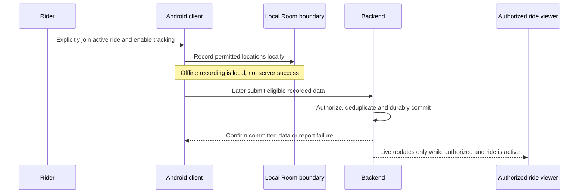

# Proposed flows, security, and privacy

All mechanisms here are **Proposed** unless described as an approved product constraint. They are review models, not approved schemas, permissions, API contracts, or evidence of implementation. The relevant decision records are linked in each section.

## Identity and authorization

**Approved:** Phone-number OTP authentication; immediately deactivate accounts on deletion request. **Proposed:** verify the chosen provider's credential server-side, map it to a Groupify identity, and check server-side account state on each protected request and WebSocket action. A valid provider session alone must not override deactivation or grant community/ride access. Apply rate/abuse protections without recording OTPs, secrets, or full tokens in logs. OTP provider, limits, identity linkage, deletion propagation and recovery steps remain open. [ADR-004](architecture-decisions/ADR-004-otp-identity.md), [ADR-015](architecture-decisions/ADR-015-security-retention.md)

**Open question:** The matrix in [business rules](../00-product/business-rules.md#role-and-permission-matrix) records the approved starter permissions but remains incomplete, including detailed role assignment and historical-location access. Deny a not-yet-authorized action in an implementation until an owner-approved policy exists, rather than using this proposal as the missing policy.

## Communities and ride lifecycle

**Approved:** A permanent community can have multiple rides, immediate or scheduled, with routes and breakpoints; completed rides have history. Leaders and Co-leaders manage rides and invitations. **Proposed:** keep community membership, ride participation and tracking consent distinct, and authorize each active-ride action against current server state. Scheduled, active and completed are concepts needed to discuss approved capabilities, not a final state machine or transition contract. Exact transition rules, separate ride leadership, membership eligibility, cancellation, offline transitions and role succession remain open.

The owner confirmed2026-11-14 that community Leaders/Co-leaders manage start/end.
The [internal lifecycle increment](../02-database/ride-lifecycle-core.md) implements
explicit serialized transitions under that authority without participation,
tracking consent or active-ride communication/location grants. Other role,
invitation, offline and lifecycle details in the preceding proposal remain open.

## Active location and later synchronization

**Approved:** Sharing occurs only during an active ride, after explicit join and tracking enablement; GPS adapts to movement, speed, battery and network conditions; background/screen-off tracking, offline local recording, last-known display, later synchronization and 30-day detailed-location retention subject to legally required retention are required. The interface distinguishes locally recorded, successfully uploaded and remotely received states. **Proposed:** label last-known as such and substantiate each state with its own evidence. Upload of buffered active-ride records after a ride ends is a distinct proposed historical synchronization path, never permission to resume live sharing. Its eligibility, audiences and retention clock remain open. If the client cannot establish whether the ride is still active while offline, privacy-safe behavior and subsequent reconciliation require an explicit decision. [ADR-009](architecture-decisions/ADR-009-gps-sampling.md), [ADR-011](architecture-decisions/ADR-011-offline-sync.md)

## PTT control and audio

**Approved:** Tap starts speaking, a second tap stops it; only one speaker at a time; all active ride members may speak; Leader and Co-leader have priority; no automatic speaking-duration timeout. Background/locked-screen operation requires Android validation.

**Proposed:** On a speak request, the control service rechecks current ride membership and account state, arbitrates the ride-scoped grant, and binds the grant to media publication. Ending speech relinquishes the grant. A disconnect, audio-session termination, or loss of independently verified liveness triggers recovery; elapsed speaking duration by itself does not. Reconnect rechecks authorization and current arbitration before resuming. A monotonically fenced grant or equivalent enforcement at the media boundary must prevent two publishers after Redis loss, partitions, or delayed reconnects. If the system cannot determine whether the prior session is still healthy, fail closed rather than grant a second speaker; availability and false-positive recovery remain risks. Interrupting a healthy speaker for priority is explicitly open, not assumed. [ADR-006](architecture-decisions/ADR-006-ptt-transport.md), [ADR-012](architecture-decisions/ADR-012-ptt-arbitration.md)

Android while-in-use microphone permissions, foreground-service start restrictions, audio focus, device vendors, process death and locked-screen controls require physical-device evidence. Neither a background task nor a WebSocket alone proves continuous microphone access.

## Chat, push, and SOS

**Approved:** Active ride participants can use group text chat, which has delivery/read status, Leader announcements, and offline queuing and synchronization where required. **Proposed:** persist an authorized message before acknowledging server success; model local queued, server accepted, delivered and read as distinct outcomes where supported. Additional audiences, receipt semantics and detailed offline behavior remain open. WebSocket delivery and FCM push are separate; FCM send acceptance does not prove a device received, displayed, or read a message. [ADR-014](architecture-decisions/ADR-014-realtime-notifications.md)

**Approved:** Active ride participants can manually trigger SOS; it alerts active ride members, attaches live or last-known location when available, remains visible until resolved, can be resolved by Leader or Co-leader, and retains emergency history. **Proposed:** recheck ride/account/role context on the server, record emergency state durably, and attempt live notification and push without claiming delivery until evidence supports it. Distinguish a local activation attempt from server acceptance and recipient receipt. No-location behavior, offline delivery, other resolution permissions and emergency-history retention remain open; do not promise offline delivery or external emergency contacts.

## Retention, deletion, and privacy

**Approved:** Detailed location history is retained for 30 days subject to legally required retention. Account deletion immediately deactivates the account, allows a 30-day recovery period, then permanently deletes personal data subject to legal retention. **Proposed:** inventory personal data across Room, server databases, object storage, provider accounts, notifications, logs, caches and backups; enforce the two different clocks separately; invalidate authorization at the server; use deletion markers or equivalent to prevent restored backups from resurrecting data; and verify provider deletion separately. A device offline during a deletion request cannot be represented as server-deactivated until the server confirms it.

**Open questions:** The event starting location retention, applicable legal obligations and their enforcement, local copy expiry, recovery workflow, shared-record treatment, provider deletion, backup expiry/restore handling and emergency-history retention need owner/legal decisions. Do not treat the approved legal qualification as a blanket extension. [ADR-015](architecture-decisions/ADR-015-security-retention.md)

**Proposed safeguards:** Use encrypted transport, protect keys and tokens in platform-appropriate secure storage, apply least-privilege server checks, restrict stored raw locations and avoid sensitive data in notification bodies, analytics and logs. Storage encryption, access policy and key management need explicit review; Room alone is not an encryption guarantee. Record no OTP, credential, production location, or emergency contents in test evidence.
