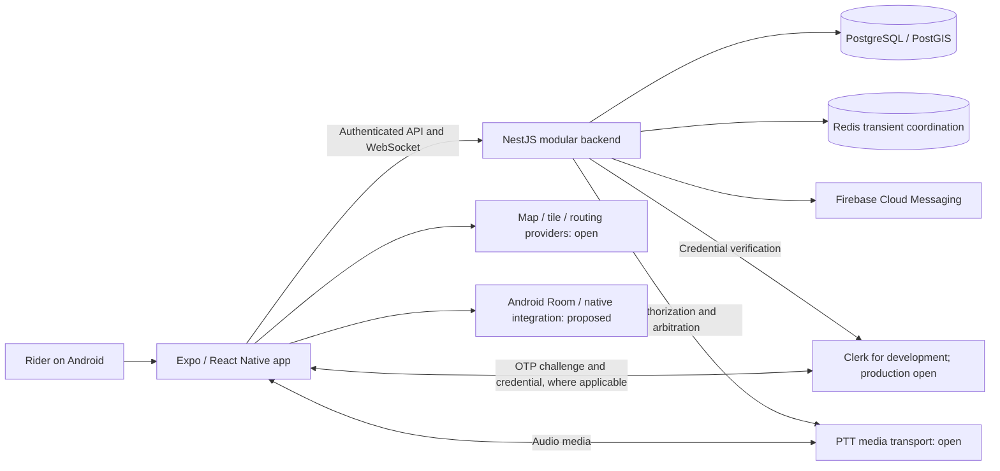

# Groupify system architecture

## Status and boundaries

This is an architecture for review, not an implementation, schema, API contract, or deployment. [Phase 0](../00-product/product-requirements.md) remains the product baseline. The owner selected Expo/React Native as the primary Android stack and a TypeScript/NestJS modular monolith as the backend direction; [ADR-001](architecture-decisions/ADR-001-client-stack.md) and [ADR-002](architecture-decisions/ADR-002-backend.md) record those decisions. Material 3, MVVM, Clean Architecture, Room, Kotlin 2.0+ for Kotlin native functionality, Coroutines, and Flow remain approved directions.

Details and workflows below are **proposed**, unless explicitly labeled approved. Clerk is approved for development, while production identity and external providers remain open. Material decisions are recorded in the [decision index](architecture-decisions/README.md). No hosting provider, numeric concurrency target, or dependency version is implied by a diagram.

## System context

**Approved directions:** NestJS modular monolith, PostgreSQL, PostGIS, Redis, WebSockets, FCM, an OSM-based mapping ecosystem, and native in-app PTT. Their appearance does not select a deployment arrangement, production identity provider, map service, or audio transport. The diagram is logical: access to media, location, and providers must be governed by the server-side boundaries below rather than by UI navigation alone.

## Android client boundaries

| Proposed boundary | Responsibility | Approved constraint / unresolved detail |
| --- | --- | --- |
| Presentation | Expo Router screens, accessible React Native views, and view-model/state adapters. | MVVM and Material 3 direction retained; design-reference differences remain open. |
| Domain | Platform-independent use cases and permission decisions presented to the user; no authority over server permissions. | Clean Architecture; exact interfaces and error contracts are unapproved. |
| Data and identity | Repository ports for session, API, WebSocket, maps, offline state, and entitlements. | Clerk is approved for development; the production OTP vendor and provider adapters remain open. No secret belongs in the client. |
| Android native | Candidate Expo native module for Room-backed outbox/recording and Kotlin Coroutines/Flow; device location, microphone, audio focus, and lifecycle adapters. | Room and Kotlin asynchronous directions are retained. The module boundary, background operation, and dependencies are proposed in [ADR-013](architecture-decisions/ADR-013-native-integration.md). |
| Build boundary | Continuous Native Generation, config plugins, and development builds for native functionality. | Do not hand-edit generated root `android/` or `ios/`. A JavaScript update cannot add native code, permissions, or configuration absent from the installed binary. |

`@expo/ui` is already installed and its Android components can use Compose internally. The approved change concerns the primary app implementation; it neither prohibits native Compose-backed controls nor approves a particular UI library. A Material 3 implementation and design tokens remain to be validated.

## Backend modules and data ownership

The following boundaries are proposed logical modules, not a database schema, service count, or approved API:

| Module | Proposed ownership and responsibility |
| --- | --- |
| Identity and account lifecycle | Link a verified provider identity to a Groupify account; enforce account state, deactivation, recovery and deletion. An external provider does not own Groupify authorization. |
| Profiles | Rider name, picture reference, rider type, and optional vehicle information; picture storage provider is open. |
| Communities and membership | Durable community, membership and role relationships using exactly Leader, Co-leader and Member. The creator becomes Leader; detailed invitation methods and leadership boundaries remain open. |
| Rides and routes | A permanent community can contain multiple immediate or scheduled rides; route and breakpoint information and completed history belong to the ride domain. The exact lifecycle and authorization are open. |
| Location and sync | Active-ride tracking state, recorded location data, last-known state, retention, reconciliation and access checks. Detailed location has a distinct 30-day policy. |
| Realtime and PTT control | WebSocket connection authorization and event routing; proposed ride-scoped arbitration and media authorization. A media provider is not the authority for product membership. |
| Chat and notifications | Active-ride participant text chat, delivery/read state and Leader announcements; authorized WebSocket delivery and FCM wake/notification hints. Additional chat scope and other role permissions remain open. |
| Emergency | Manual active-ride SOS, authorized alert routing, live or last-known location association, resolution, and retained emergency history. External contacts remain later scope. |
| Entitlements | Purchase verification and server-side access decisions. SOS, essential communication and basic navigation remain free; prices and feature limits remain open. |
| Operations and audit | Limited, redacted operational evidence, alerting, backup/restore and deletion/retention execution. The audit schema, retention and provider are unselected. |

**Proposed data ownership:** PostgreSQL/PostGIS is the durable source for product records and recorded locations; Redis is transient coordination/cache and must not be treated as sole durable storage. Room holds device-local recording/outbox data and related metadata. Provider-held identity, maps, media, and push data follow separate contracts that must be researched and approved. Boundaries and eventual storage formats are not a schema.

## Cross-cutting flows

- **Authentication and authorization:** A phone OTP is verified by the selected identity mechanism. The backend validates the resulting credential and independently checks account state, membership, role, ride state and action on every protected API and WebSocket operation. Clerk is approved for development; production identity and some permissions remain open. [ADR-004](architecture-decisions/ADR-004-otp-identity.md)
- **Community and ride:** Community membership and ride participation are distinct concepts. Active-ride join and tracking enablement are explicit; Leaders and Co-leaders manage rides and invitations. Detailed transition and invitation rules, role assignment and separate leadership remain open. A completed ride can appear in history.
- **Location and offline:** While an active ride and explicit opt-in permit tracking, the device can record locally while disconnected and later synchronize. Live sharing is limited to the active ride; historical upload and historical visibility must not be confused with live sharing. [ADR-011](architecture-decisions/ADR-011-offline-sync.md)
- **PTT:** Active ride members use native in-app audio, tap to start and tap again to stop; at most one speaker is active, with Leader/Co-leader priority. Stale-session recovery is required; its mechanism, priority behavior and transport are proposed, never a speaking-duration timeout. [ADR-006](architecture-decisions/ADR-006-ptt-transport.md), [ADR-012](architecture-decisions/ADR-012-ptt-arbitration.md)
- **Chat, SOS and notification:** Durable server state and authorized real-time delivery are distinct from FCM push, which must not be treated as proof of receipt. SOS is manual, ride-scoped and free; it alerts active ride members with live or last-known location. Leader or Co-leader can resolve it, and emergency history is retained. [ADR-014](architecture-decisions/ADR-014-realtime-notifications.md)
- **Entitlements:** Server-verified entitlements apply only to features eventually approved as premium. The free guarantees are invariant, including during billing failures. [ADR-010](architecture-decisions/ADR-010-subscriptions.md)
- **Retention and deletion:** Detailed location history has a 30-day retention period subject to legally required retention. Account deletion immediately deactivates the account, permits 30-day recovery, and then permanently deletes personal data subject to legal retention. The triggers, backups and applicable legal obligations require decisions and evidence. [ADR-015](architecture-decisions/ADR-015-security-retention.md)

See [flows and security](flows-and-security.md) for failure boundaries and [operations and testing](operations-and-testing.md) for release and evidence requirements. No diagram asserts that the current application or a server already implements these flows.
